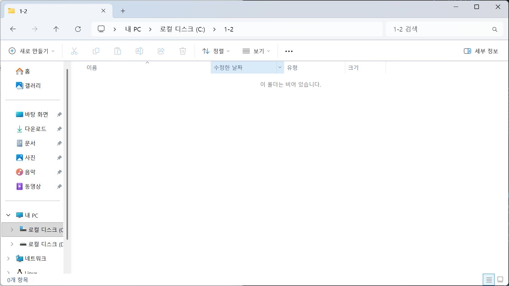
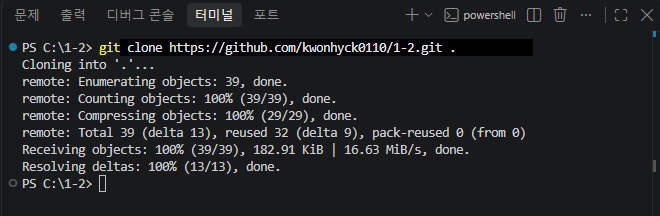
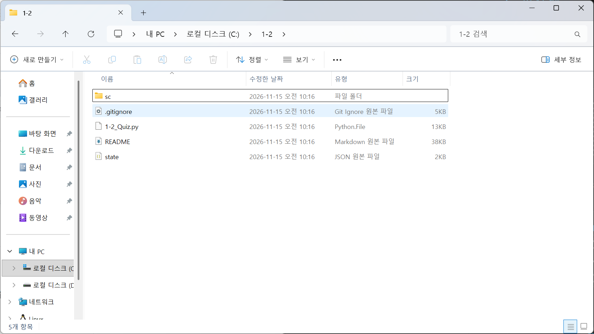

# 📘 전기·반도체 기초 상식 퀴즈 프로그램

## 1. 프로젝트 개요
이 프로젝트는 Python 기초 문법(변수, 자료형, 제어문, 함수), 객체지향 설계(클래스와 객체), 파일 입출력(JSON), 그리고 Git 버전 관리 개념을 학습하고 복습하기 위해 개발한 **콘솔 기반 대화형 퀴즈 프로그램**입니다.

사용자는 등록된 문제를 무작위 순서로 풀며 실시간으로 정답 여부를 확인하고, 새로운 퀴즈를 추가하거나 불필요한 문제를 삭제할 수 있습니다. 또한 모든 문제 데이터와 최고 점수, 플레이 히스토리는 프로젝트 루트의 `state.json` 파일에 안전하게 저장되어 프로그램을 종료한 뒤 재실행해도 데이터가 그대로 유지됩니다.

---

## 2. 퀴즈 주제와 선정 이유
* **주제**: 전기 및 반도체 공학 기초 상식 퀴즈
* **선정 이유**:
  * **전공 지식 활용**: 전기 및 반도체 공학의 핵심 기초 개념(단위, 전류 종류, 소재)과 주요 과학자·인물의 업적을 퀴즈 형태로 구성하여 전공 기초를 자연스럽게 복습하고자 했습니다.
  * **실전 프로그래밍 구조 체득**: 퀴즈 문제를 `Quiz` 객체로 모델링하고, 게임 전체 흐름과 JSON 파일 입출력을 `QuizGame` 클래스로 분리하여 유지보수가 용이한 객체지향 구조를 직접 구현해 보았습니다.

---

## 3. 실행 방법

### (1) 저장소 복제 (Clone)
```bash
git clone https://github.com/kwonhyck0110/1-2.git
cd 1-2
```

### (2) 프로그램 실행 (Python 3.8 이상 권장)
프로젝트 루트 경로에서 아래 명령어를 입력해 실행합니다.
```bash
python 1-2_Quiz.py
```

### (3) 데이터 초기화 (선택 사항)
저장된 퀴즈 목록과 점수 기록을 초기화하고 기본 6문항으로 다시 시작하려면 `state.json` 파일을 삭제한 뒤 실행하세요.
```bash
rm state.json
```

---

## 4. 주요 기능 목록
1. **🎲 퀴즈 풀기 (무작위 출제)**: `random.shuffle()`을 사용해 등록된 문제를 매번 다른 순서로 출제하고, 즉시 정답 판별 및 점수를 계산합니다.
2. **➕ 퀴즈 추가**: 사용자가 직접 문제, 4개의 선택지, 정답 번호(1~4)를 입력하여 새로운 퀴즈를 등록합니다.
3. **📋 퀴즈 목록 보기**: 현재 저장되어 있는 전체 퀴즈의 문제, 보기, 정답 번호를 한눈에 조회합니다.
4. **🏆 최고 점수 확인**: 역대 플레이에서 달성한 최고 점수를 확인합니다.
5. **📜 점수 기록 히스토리 보기**: `datetime` 모듈을 활용해 게임을 완료한 날짜·시간, 총 문제 수, 맞힌 개수를 누적 기록하고 조회합니다.
6. **🗑️ 퀴즈 삭제**: 목록에서 번호를 선택해 기존 퀴즈를 삭제하고 파일에 즉시 반영합니다.
7. **💾 안전한 파일 입출력 및 예외 복구**: UTF-8 인코딩으로 한글 깨짐 없이 데이터를 저장하며, 파일 권한 오류(`PermissionError`) 및 파일 손상(`JSONDecodeError`) 시 자동 백업(`state.json.bak`) 후 기본 데이터로 복구합니다.

---

## 5. 파일 구조
```text
1-2/
├── sc/               # 실행 결과 및 Git 워크플로우 증빙 스크린샷 폴더
├── .gitignore        # Git 버전 관리에서 제외할 파일(state.json 등) 설정 파일
├── 1-2_Quiz.py       # 퀴즈 게임 메인 실행 파일 (Quiz, QuizGame 클래스 포함)
├── README.md         # 프로젝트 설명 및 핵심 개념 정리 문서
├── state.json        # 퀴즈 목록, 최고 점수, 플레이 히스토리 저장 파일 (자동 생성)
└── state.json.bak    # state.json 손상 감지 시 자동 생성되는 백업 파일
```

---

## 6. 데이터 파일 설명 (`state.json`)

* **경로**: 프로젝트 루트 디렉터리 (`./state.json`)
* **인코딩**: UTF-8 (`ensure_ascii=False` 적용으로 한글 원문 유지)
* **역할**: 최초 실행 시 기본 제공되는 6문항(저항 단위, 엔비디아 창업자, 교류 개념, 맥스웰, 반도체, 구리)과 사용자가 추가·삭제한 퀴즈 목록, 최고 점수, 날짜별 히스토리를 영구 저장합니다.

### 전체 JSON 구조
```json
{
  "quizzes": [
    {
      "question": "전기에서 저항을 나타내는 단위는?",
      "choices": ["볼트", "옴", "암페어", "와트"],
      "answer": 2
    }
  ],
  "best_score": 6,
  "history": [
    {
      "date": "2026-11-11 12:00:00",
      "total": 6,
      "score": 6
    }
  ]
}
```

### 최상위 필드 명세
| 필드명 | 자료형 | 설명 |
| :--- | :--- | :--- |
| `quizzes` | `list[dict]` | 등록된 개별 퀴즈 데이터 객체들의 목록 |
| `best_score` | `int` | 사용자가 기록한 역대 최고 점수 |
| `history` | `list[dict]` | 플레이 일시(`date`), 총 문항 수(`total`), 득점(`score`) 기록 목록 |

### `quizzes` 내부 객체 명세
| 필드명 | 자료형 | 설명 |
| :--- | :--- | :--- |
| `question` | `str` | 출제할 문제 내용 |
| `choices` | `list[str]` | 4개의 객관식 선택지 목록 |
| `answer` | `int` | 정답 번호 (**1부터 시작**, 1~4 사이의 정수) |

> 💡 **참고**: 배열 인덱스(0~3)와 달리 사용자 직관성을 위해 `answer`는 **1번부터 4번** 기준으로 저장됩니다. 예를 들어 `choices`가 `["볼트", "옴", "암페어", "와트"]`이고 `answer`가 `2`라면 정답은 **"옴"**입니다.

---

## 7. 핵심 개념 정리 및 코드 적용 사례

이 프로젝트를 개발하면서 배운 Python, 객체지향, 파일 입출력, Git의 핵심 개념들이 실제 코드에서 어떻게 동작하는지 정리했습니다.

### 7-1. Python 기초 문법

#### 🔹 변수 (Variable)
변수는 프로그램이 실행되는 동안 데이터를 메모리에 담아두고 이름으로 불러 쓰는 저장 공간입니다. 같은 값을 여러 번 재사용하거나 상태 변화(점수 증가 등)를 추적하기 위해 사용합니다.
* **코드 적용**: `score = 0`(현재 맞힌 개수), `total = len(play_quizzes)`(전체 문제 수)처럼 게임 진행 상태를 추적할 때 활용했습니다.

#### 🔹 주요 자료형 (`int`, `str`, `bool`, `list`, `dict`)
| 자료형 | 특징 및 용도 | 프로젝트 내 실제 활용 사례 |
| :--- | :--- | :--- |
| **`int`** (정수) | 사칙연산 및 크기 비교가 가능한 숫자 | 정답 번호(`2`), 맞힌 점수(`score`), 최고 기록(`best_score`) |
| **`str`** (문자열) | 텍스트 데이터를 표현 | 문제 지문(`question`), 선택지 문구, 기록 일시(`"2026-11-11 12:00:00"`) |
| **`bool`** (논리형) | 참(`True`) 또는 거짓(`False`) 판별 | `quiz.is_correct(user_ans)` 메서드의 정답 일치 여부 반환값 |
| **`list`** (리스트) | 순서가 있고 수정(`append`, `pop`) 가능한 목록 | 4지선다 보기(`choices`), 전체 퀴즈 목록(`self.quizzes`), 기록(`self.history`) |
| **`dict`** (딕셔너리) | `Key: Value` 쌍으로 데이터를 구조화하여 빠르게 조회 | JSON 파일로 저장·복원하기 위한 직렬화 데이터 구조(`to_dict()`) |

#### 🔹 조건문 (`if` / `elif` / `else`)
조건식의 참·거짓 여부에 따라 프로그램의 실행 흐름을 분기합니다.
* **코드 적용**: 메인 메뉴(`run()`)에서 사용자가 선택한 번호(`1`~`7`)에 따라 각기 다른 기능을 호출하거나, `play_quiz()`에서 정답 여부에 따라 점수를 올리고 최고 기록 갱신 여부를 판단할 때 사용했습니다.

#### 🔹 반복문 (`for` vs `while`)
* **`for` 문**: 리스트나 범위(`range`)처럼 **반복할 대상과 횟수가 명확할 때** 사용합니다. (예: 전체 퀴즈 목록을 1번부터 끝까지 순회하며 출제할 때)
* **`while` 문**: 종료 조건이 만족될 때까지 **횟수 제한 없이 계속 반복해야 할 때** 사용합니다. (예: 사용자가 `7) 종료`를 누르기 전까지 메뉴를 계속 띄우거나, `read_int()`에서 올바른 숫자를 입력할 때까지 재입력을 요구할 때)

#### 🔹 함수 (Function)
특정 기능을 수행하는 코드 블록을 `def` 키워드로 묶어 재사용성과 가독성을 높입니다. 외부에서 입력값을 받는 **매개변수(Parameter)**와 실행 결과를 돌려주는 **반환값(`return`)**으로 구성됩니다.
* **코드 적용**: 숫자 입력 검증 로직을 `read_int(self, prompt, min_v, max_v)` 함수로 분리하여 메뉴 선택, 정답 입력, 퀴즈 삭제 번호 입력 등 여러 곳에서 중복 코드 없이 재사용했습니다.

---

### 7-2. 클래스와 객체 (객체지향 설계)

#### 🔹 클래스(Class)와 객체(Object)를 사용하는 이유
클래스는 관련된 **데이터(속성)**와 **기능(메서드)**을 하나로 묶어낸 **설계도**이며, 이 설계도를 바탕으로 메모리에 생성된 실체를 **객체(인스턴스)**라고 합니다. 퀴즈 데이터가 늘어날 때마다 변수들을 따로 관리하면 구조가 복잡해지므로, 역할에 따라 두 개의 클래스로 책임을 명확히 분리했습니다.

* **`Quiz` 클래스 (개별 문제 데이터 모델)**
  * 하나의 문제가 가지는 질문(`question`), 보기(`choices`), 정답(`answer`) 속성을 캡슐화합니다.
  * 문제 출력(`show`), 정답 판별(`is_correct`), JSON 변환(`to_dict`, `from_dict`) 기능을 전담합니다.
* **`QuizGame` 클래스 (게임 전체 흐름 및 상태 컨트롤러)**
  * 프로그램의 전체 생명주기를 총괄합니다.
  * **주요 책임**:
    1. **파일 입출력 및 복구**: `state.json` 데이터 불러오기(`load`), 저장(`save`), 손상 시 백업 생성
    2. **콘솔 메뉴 제어**: 사용자 메뉴 출력(`show_menu`) 및 기능 분기 실행(`run`)
    3. **게임 운영 및 기록 관리**: 무작위 셔플 출제(`play_quiz`), 퀴즈 추가(`add_quiz`)·삭제(`delete_quiz`), 최고 점수 및 일시별 히스토리 관리(`show_history`)
    4. **입력 안전성 보장**: 빈 문자열이나 범위 밖 숫자를 걸러내는 입력 검증(`read_int`, `read_text`)

#### 🔹 `__init__` 메서드와 `self`의 역할
* **`__init__` (생성자)**: `Quiz(...)` 또는 `QuizGame()`으로 새 객체를 생성할 때 자동으로 호출되어 초기 속성을 세팅합니다. `QuizGame`의 경우 객체 생성과 동시에 `self.load()`를 호출해 기존 저장 데이터를 자동으로 불러옵니다.
* **`self`**: 메서드를 호출한 **객체 자기 자신**을 가리키는 첫 번째 매개변수입니다. `self`가 있기 때문에 여러 개의 `Quiz` 객체가 각각 서로 다른 문제와 정답 데이터를 독립적으로 유지할 수 있습니다.

#### 🔹 속성(Attribute)과 메서드(Method) 구분
* **속성 (데이터)**: 객체가 보유한 상태 값 (예: `self.question`, `self.quizzes`, `self.best_score`)
* **메서드 (동작)**: 객체가 수행하는 함수 (예: `quiz.is_correct()`, `game.play_quiz()`, `game.save()`)

---

### 7-3. 파일 입출력과 예외 처리

#### 🔹 안전한 파일 열기·읽기·쓰기 (`with open`)
프로그램이 종료되어도 데이터가 날아가지 않도록 `with open(파일명, 모드, encoding="utf-8")` 구문을 사용합니다. `with` 블록을 벗어나면 파일이 자동으로 닫히므로 리소스 누수나 파일 손상을 방지할 수 있으며, `encoding="utf-8"` 지정을 통해 한글 깨짐을 예방합니다.

#### 🔹 JSON 형식을 사용하는 이유
JSON(JavaScript Object Notation)은 중괄호(`{}`)와 대괄호(`[]`)로 이루어진 텍스트 기반 데이터 포맷입니다. Python의 `dict` 및 `list` 자료형과 구조가 1:1로 일치하여 `json.load()`(읽기)와 `json.dump()`(저장)만으로 복잡한 객체 데이터를 손쉽게 변환하고 사람이 직접 열어볼 수도 있습니다.

#### 🔹 예외 처리 (`try` / `except`) 및 복구 절차
실행 중 예기치 못한 오류로 프로그램이 강제 종료(Crash)되는 것을 막기 위해 다단계 예외 처리를 적용했습니다.
* **`FileNotFoundError` 대응**: 첫 실행 시 `state.json`이 없으면 오류 대신 기본 6문항(`get_default_quizzes()`)으로 게임을 시작합니다.
* **`PermissionError` 대응**: 파일 읽기/쓰기 권한이 거부된 경우 안내 메시지를 출력하고 안전하게 동작을 이어갑니다.
* **`JSONDecodeError` 등 손상 복구 절차**: 파일 내용이 깨졌을 경우 `shutil.copy()`로 원본을 `state.json.bak`에 백업해 둔 뒤, 기본 데이터로 복구하여 게임 진행을 보장합니다.
* **`ValueError` 대응**: 숫자를 입력해야 하는 곳에 문자를 입력해도 프로그램이 멈추지 않고 재입력을 안내합니다.

---

### 7-4. 대규모 데이터(퀴즈 1,000개 이상) 처리 시 성능 평가 및 설계 검토

* **현재 구조의 한계 분석**:
  * `load()` 실행 시 `state.json` 전체를 한 번에 메모리(`self.quizzes` 리스트)로 적재하므로 데이터가 수천~수만 건으로 늘어나면 RAM 점유율이 높아집니다.
  * 퀴즈 1건만 추가·수정해도 파일 전체를 덮어쓰는(`json.dump`) 구조이므로 파일 I/O 병목과 선형 탐색(`O(N)`) 지연이 발생할 수 있습니다.
* **확장 대응 설계 방안**:
  1. **지연 로딩 (Lazy Loading / Pagination)**: 전체 문제를 한 번에 읽지 않고 출제 또는 목록 조회 시 필요한 개수(예: 10~20문항 단위)만 부분 로드합니다.
  2. **해시 인덱싱 (Indexing)**: 문제 ID나 키워드 검색 시 Python `dict` 기반 인덱스(`O(1)`)를 구축하여 탐색 속도를 개선합니다.
  3. **경량 데이터베이스 전환 (`SQLite`)**: 데이터가 1,000건 이상으로 확장될 경우 별도 서버 설치가 필요 없는 내장 RDB인 `SQLite`로 전환하여, `LIMIT/OFFSET` 페이징 쿼리와 트랜잭션(ACID) 기반 부분 업데이트를 적용하는 것이 적합합니다.

---

## 8. Git 버전 관리 및 협업 워크플로우

### 8-1. Git의 필요성과 3가지 작업 영역
**Git**은 소스 코드의 변경 이력을 스냅샷 단위로 기록하는 분산 버전 관리 시스템입니다. 파일명을 `최종_진짜최종.py`처럼 늘리지 않고도 과거 시점으로 안전하게 복구할 수 있으며, 원격 저장소(GitHub)를 통해 백업과 협업을 수행합니다.

```text
[작업 디렉터리] ──(git add)──▶ [스테이징 영역] ──(git commit)──▶ [로컬 저장소] ──(git push)──▶ [원격 저장소(GitHub)]
```

### 8-2. 핵심 명령어 7종 정리
| 명령어 | 역할 및 설명 |
| :--- | :--- |
| **`git init`** | 현재 프로젝트 폴더를 Git 로컬 저장소로 초기화합니다. |
| **`git add`** | 수정하거나 새로 만든 파일을 커밋 대기 공간(Staging Area)에 등록합니다. |
| **`git commit`** | 스테이징된 변경 사항에 설명 메시지를 붙여 하나의 버전으로 영구 기록합니다. |
| **`git push`** | 로컬 저장소의 커밋 이력을 원격 저장소(GitHub)로 업로드합니다. |
| **`git pull`** | 원격 저장소의 최신 변경 사항을 내려받아 로컬 브랜치에 즉시 병합합니다. |
| **`git checkout`** | 작업할 브랜치를 전환하거나 새 브랜치를 생성(`-b`)합니다. |
| **`git clone`** | GitHub 원격 저장소의 전체 코드와 이력을 내 컴퓨터로 처음 복제해 옵니다. |

### 8-3. 작업 단위 규정 및 커밋 메시지 컨벤션
* **작업 단위 규정**: 하나의 기능 구현, 하나의 버그 수정, 하나의 문서 보완당 **1개의 독립된 커밋**을 생성하여 변경 이력을 명확히 추적할 수 있도록 관리합니다.
* **커밋 메시지 템플릿**: `<Type>: <작업 내용 요약>` 형식을 사용합니다.
  * `Feat`: 새로운 기능 추가 (예: `Feat: 퀴즈 삭제 기능 추가 및 state.json 동기화 처리`)
  * `Fix`: 오류 및 예외 처리 수정 (예: `Fix: PermissionError 예외 처리 및 백업 복구 추가`)
  * `Docs`: 문서 작성 및 수정 (예: `Docs: README 프로젝트 설명 및 개념 정리 보완`)
  * `Refactor`: 기능 변경 없는 코드 구조 개선 (예: `Refactor: 입력 검증 로직 read_int 함수로 분리`)
  * `Chore`: `.gitignore` 등 환경 설정


### 8-4. 브랜치(Branch) 분기 및 병합(Merge)
메인 코드(`main`)의 안정성을 유지하면서 새로운 기능을 안전하게 개발하기 위해 기능 브랜치(`feature/...`)를 생성해 작업한 뒤, 검증이 완료되면 `main` 브랜치로 병합합니다.

```bash
git checkout -b feature/quiz-game   # 1. 기능 개발용 브랜치 생성 및 이동
# ... 기능 구현 및 커밋 ...
git checkout main                   # 2. 메인 브랜치로 복귀
git merge feature/quiz-game         # 3. 개발 완료된 기능 병합
```


### 8-5. 원격 저장소 동기화 (`clone` & `pull`)
| 1. Clone 전 | 2. 명령어 실행 | 3. Clone 후 |
| :---: | :---: | :---: |
|  |  |  |

---

## 9. 요구사항 변경 시 수정 대상 체크리스트 (유지보수 가이드)

향후 새로운 기능이 추가되거나 기존 규칙이 변경될 때 수정해야 할 클래스, 메서드 및 저장소(`state.json`) 필드 체크리스트입니다.

### 1) 점수 계산 방식 변경 시 (예: 문제별 차등 배점, 오답 감점제)
* [ ] **퀴즈 모델 (`Quiz` 클래스)**
  * `__init__`: 배점 속성(`self.points = 10` 등) 추가
  * `to_dict()` / `from_dict()`: 직렬화 및 복원 로직에 `"points"` 필드 반영
* [ ] **게임 컨트롤러 (`QuizGame` 클래스)**
  * `play_quiz()`: 정답 시 고정 `+1` 대신 `score += quiz.points` 또는 오답 감점 로직 수정
  * `add_quiz()`: 새 퀴즈 등록 시 문제 배점을 입력받는 절차 추가
* [ ] **저장 포맷 (`state.json`)**
  * `quizzes` 배열 내부 객체에 `"points"` 필드 추가

### 2) 퀴즈 데이터 모델 확장 시 (예: 정답 해설, 힌트, 난이도 추가)
* [ ] **퀴즈 모델 (`Quiz` 클래스)**
  * `__init__`: 신규 속성(`self.explanation`, `self.difficulty`) 추가
  * `show()`: 문제 출력 시 난이도 또는 힌트 표시 로직 반영
  * `to_dict()` / `from_dict()`: 기존 데이터 호환을 위해 `.get("explanation", "")` 기본값 처리 추가
* [ ] **게임 컨트롤러 (`QuizGame` 클래스)**
  * `play_quiz()`: 정답/오답 판별 직후 해설(`quiz.explanation`) 출력 구문 추가
  * `add_quiz()`: 퀴즈 생성 시 신규 항목을 입력받는 `read_text()` 로직 추가
* [ ] **저장 포맷 (`state.json`)**
  * `quizzes` 각 요소에 `"explanation"`, `"difficulty"` 필드 확장

### 3) 저장 포맷 및 기록 구조 변경 시 (예: 플레이어 이름, 풀이 소요 시간 기록)
* [ ] **게임 컨트롤러 (`QuizGame` 클래스)**
  * `load()` / `save()`: 최상위 딕셔너리 구조에 신규 상태 변수 매핑 및 기본값 처리
  * `play_quiz()`: 시작~종료 시간(`time` 모듈) 측정 후 `history` 기록 딕셔너리에 추가
  * `show_history()`: 기록 출력 포맷에 추가된 항목(소요 시간, 플레이어명 등) 반영
* [ ] **저장 포맷 (`state.json`)**
  * `history` 배열 내부 객체 스키마에 `"duration"`, `"player"` 등의 신규 필드 추가

---

## 10. 작성자 정보
* **작성자**: 권혁 (`kwonhyck0110`)
* **GitHub 저장소**: [https://github.com/kwonhyck0110/1-2.git](https://github.com/kwonhyck0110/1-2.git)
* **최종 수정일**: 2026-11-11